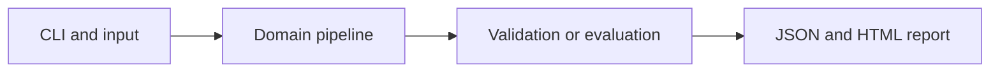

# Biology Methods Literature RAG

Retrieve research-method notes, draft a source-linked answer and keep observed evidence separate from interpretation.

**Category:** Biology / RAG / Generative AI

**Execution:** Fixture replay by default; optional actual local-LLM generation. Live integration is implemented but not verified in this build.

## Run

```sh
python -m venv .venv
# Windows: .venv\Scripts\activate
# macOS/Linux: source .venv/bin/activate
python -m pip install -r requirements.txt
python app.py
python -m unittest discover -v
```

Open `results/report.html` after running. Python 3.10+ is required. Use `--help` for input and seed options.

For actual generation with a running Ollama installation and downloaded model:

```sh
python app.py --mode live --model YOUR_INSTALLED_MODEL
```

Model installation is separate and may require substantial memory. No silent fallback to fixtures is used. See [Ollama generation API](https://docs.ollama.com/api/generate) and [structured outputs](https://docs.ollama.com/capabilities/structured-outputs).

## Architecture



## Algorithm

Use BM25 over short project-authored method notes carrying links to primary sources. Live mode asks a local LLM for a structured answer and citations; replay mode validates a supplied answer.

## Evaluation

Test unknown source rejection and unsupported questions. Citation identifiers must belong to the retrieved context, and quote spans must occur literally in that source note.

## Limitations

Notes are brief paraphrases rather than a comprehensive literature corpus. Citation validation does not prove scientific entailment or consensus, and generated answers are not medical advice.

## Documentation

- [PDF project guide](PROJECT_GUIDE.pdf)
- [Editable guide](GUIDE.md)
- [Model and system card](MODEL_CARD.md)
- [Measured results](results/metrics.json)
- [Test output](TEST_RESULTS.txt)

## Extend it

Ingest licensed full texts with versioned provenance, compare lexical and semantic retrieval, label claim support and evaluate contradictory sources.

AI-assisted educational project with synthetic data. Review, customize and explain your own contribution accurately. MIT license.

## Biology scope and current relevance

Default inputs are synthetic or project-authored. No clinical deployment or wet-lab validation is claimed. See [research context](RESEARCH_CONTEXT.md) and [data provenance](DATA_PROVENANCE.md).

- [Universal cell embedding provides a foundation model for cell biology](https://www.nature.com/articles/s41586-026-10689-z) (2026)
- [Benchmarking algorithms for generalizable single-cell perturbation response prediction](https://www.nature.com/articles/s41592-025-02980-0) (2025/2026)
